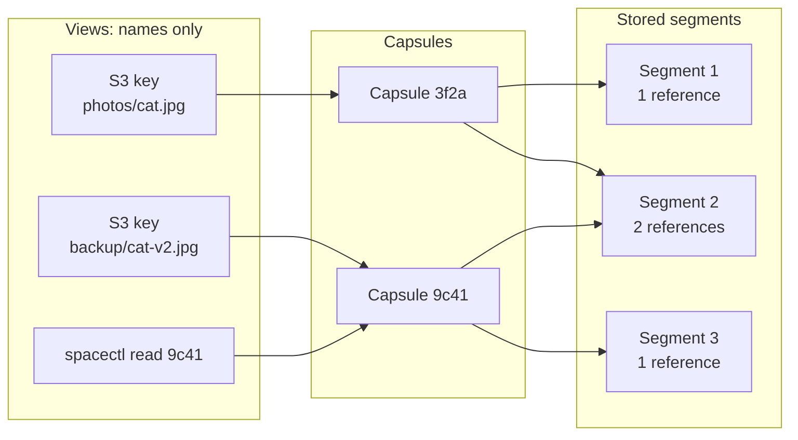
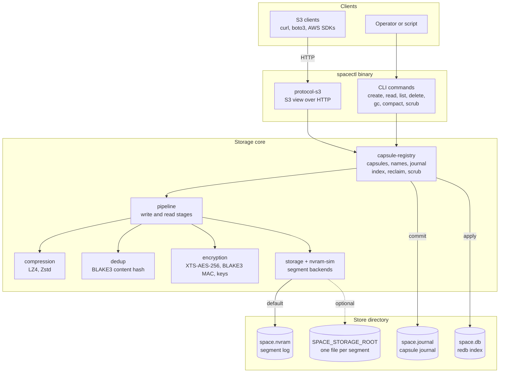
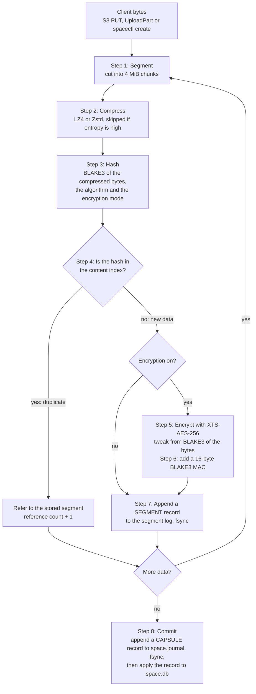
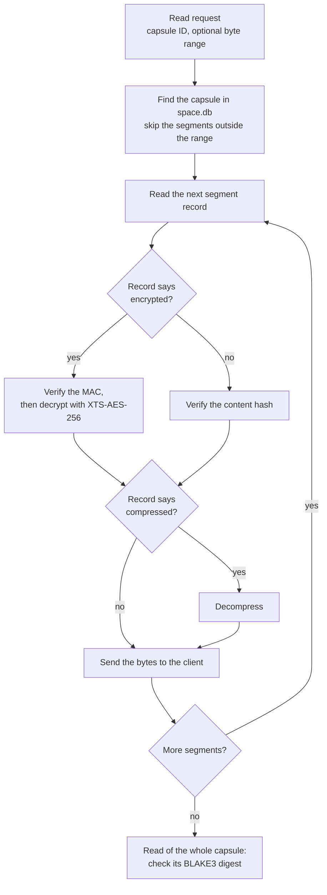
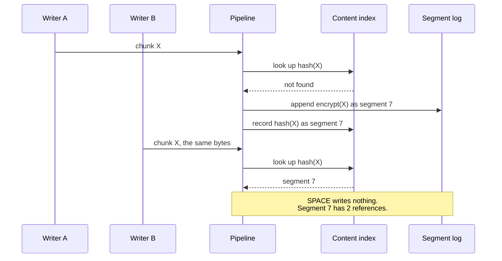

# SPACE

[](https://github.com/saworbit/SPACE/actions/workflows/ci.yml)
[](https://github.com/saworbit/SPACE/actions/workflows/codeql.yml)
[](https://scorecard.dev/viewer/?uri=github.com/saworbit/SPACE)
[](LICENSE)

**Storage Platform for Adaptive Computational Ecosystems**

**One capsule. Multiple views. Zero copies.**

> [!WARNING]
> SPACE is a pre-alpha research project. Do not keep the only copy of important data in it. One developer maintains SPACE, and the APIs will change.

## Contents

- [What SPACE is](#what-space-is)
- [Architecture](#architecture)
- [Data flow](#data-flow)
- [What works today](#what-works-today)
- [Quick start](#quick-start)
- [Limits and trade-offs](#limits-and-trade-offs)
- [Documentation](#documentation)
- [Project history](#project-history)
- [Contributing](#contributing)
- [License](#license)

## What SPACE is

SPACE is a storage engine for one computer. It keeps all data as **capsules**. A capsule is a stored object with a permanent 128-bit ID.

Clients use **views** to read and write capsules. A view gives names to capsules, but it does not own the bytes. This branch has two views:

- **The S3 view** (`spacectl serve-s3`) is an S3-compatible HTTP server. Each S3 key is a name that points to a capsule.
- **The `spacectl` command-line tool** reads and writes capsules by their IDs.

`spacectl` can read an object that a client put through S3, because the object is a capsule. SPACE does not make a copy for the second view.

Each capsule is an ordered list of **segments**. A segment holds up to 4 MiB of data by default. When two capsules contain the same segment, SPACE stores that segment one time only. Each stored segment has a reference count.



### How encryption keeps deduplication

The write pipeline compresses, deduplicates and encrypts each segment. Encryption and deduplication usually conflict. If a system encrypts data before it looks for duplicates, two copies of the same data usually give different ciphertext. The system then cannot find the duplicates.

SPACE does the steps in this sequence:

1. It compresses the segment.
2. It calculates a BLAKE3 hash of the compressed bytes. The hash input also includes the compression algorithm and the encryption mode. Thus segments from different policies never match by mistake.
3. It looks for the hash in the content index. If the hash is there, the new capsule refers to the stored segment, and SPACE writes nothing.
4. If the hash is new, SPACE encrypts the segment with XTS-AES-256. The XTS tweak is the first 16 bytes of a BLAKE3 hash of the compressed segment. The same bytes under the same key always give the same ciphertext.
5. It adds a 16-byte BLAKE3 MAC to the ciphertext, and it appends the segment to the segment log.

Every capsule that refers to a shared segment can decrypt it with the store key. Encryption does not stop deduplication. There is a cost: a person who can read the disk can see which segments are the same. That person cannot read the contents. See [Limits and trade-offs](#limits-and-trade-offs).

## Architecture

SPACE is a Rust workspace. All the parts are in one binary, `spacectl`. The diagram shows how the crates call each other and which files they write.



| Crate | Job |
|-------|-----|
| [`common`](crates/common) | Shared types (`CapsuleId`, `SegmentId`, `Policy`) and the `StorageBackend` trait. All other crates use it. |
| [`compression`](crates/compression) | LZ4 and Zstd. It does not compress data that has high entropy. |
| [`dedup`](crates/dedup) | BLAKE3 content hashes, separated by algorithm. |
| [`encryption`](crates/encryption) | XTS-AES-256, the BLAKE3 MAC and the key manager. |
| [`nvram-sim`](crates/nvram-sim) | The append-only segment log, `space.nvram`. |
| [`storage`](crates/storage) | Segment backends: the log, one file per segment, memory, and an LRU cache. |
| [`pipeline`](crates/pipeline) | The write and read stages. It is the only write path. |
| [`capsule-registry`](crates/capsule-registry) | Capsules and names. It owns the journal, the index, reclaim and scrub. |
| [`protocol-s3`](crates/protocol-s3) | The S3 view, on axum. |
| [`spacectl`](crates/spacectl) | The command-line tool and the S3 server. |
| [`test-support`](crates/test-support) | Helpers for the tests only. |

## Data flow

### Write path

S3 PUT, S3 UploadPart and `spacectl create` all use this path.



- **Step 8 is the commit point.** A write that stops before step 8 is not visible to any list or read. Reclaim removes the segments that it stored.
- **An S3 PUT is atomic.** One journal batch commits the new object, its key and the removal of the old object. After a crash, the key holds the old object or the new object.
- **Writes overlap.** A streaming write does steps 2, 3, 5 and 6 on a blocking thread before it locks the pipeline. The lock covers only steps 4 and 7, so other writes can continue. If step 4 finds a duplicate, SPACE discards the ciphertext.
- **Multipart upload does not copy data.** CompleteMultipartUpload makes the object from the segments of its parts. It does not write the parts again.

### Read path

S3 GET and `spacectl read` use this path. SPACE streams the result one segment at a time.



- **The segment record is the truth.** The read uses the flags in each segment record, not the capsule policy. Because of deduplication, a capsule can refer to segments that a different policy wrote.
- **The MAC comes first.** SPACE verifies the MAC, with a constant-time compare, before it decrypts. It does not give changed ciphertext to the AES code.
- **The policy can require encryption.** If the policy of a capsule requires encryption, SPACE refuses a segment that is marked as not encrypted.
- **A range read reads full segments.** It skips the segments outside the range. It reads each segment in the range completely.

### Shared segments

Two writers send the same chunk. SPACE stores it one time.



When the reference count of a segment goes to zero, reclaim removes it.

### What is on disk

All files are in the store directory. This is the current directory, or the directory that `--store <dir>` or `SPACE_STORE_DIR` gives.

| File | Contents | Truth or derived |
|------|----------|------------------|
| `space.journal` | One record for each capsule write and delete, and for each bucket and key change. | Truth |
| `space.nvram` | One framed, checksummed `SEGMENT` record for each segment, with its compression and encryption fields. | Truth |
| `space.db` | A [redb](https://www.redb.org) index of the journal: capsules, the content index, reference counts, buckets and keys. | Derived. If it is lost or does not match the journal, SPACE builds it again from the journal. |
| `SPACE_STORAGE_ROOT` | Optional. A directory with one file for each segment. It replaces `space.nvram`. | Truth |

The byte layouts are in [docs/on-disk-format.md](docs/on-disk-format.md).

### Background maintenance

`spacectl serve-s3` runs two loops:

- **Reclaim** runs at start and then every 5 minutes. It aborts multipart uploads that are older than 7 days. When at least a quarter of `space.nvram` is unused, it writes a new, smaller generation of the log. Under `SPACE_STORAGE_ROOT`, it deletes the segment files that no capsule uses. Then it compacts `space.journal` in the same way.
- **Scrub** reads at most 64 MiB/s. A light scrub runs every day and checks the checksums of each record. A deep scrub runs every week. It checks the MACs and content hashes, and then the digest of each capsule.

To do this work when the server is stopped, use `spacectl gc`, `spacectl compact` and `spacectl scrub`.

On SIGTERM or Ctrl-C, the server stops new connections. It gives the requests in progress 5 seconds to complete (`--shutdown-grace`). Then it stops the loops and exits.

## What works today

`cargo test --workspace` passes on `main`.

- **Capsules:** create, read, stream, range read, list and delete, through the pipeline.
- **Compression and deduplication:** LZ4 or Zstd, and BLAKE3 content-addressed deduplication.
- **Encryption:** XTS-AES-256 with a BLAKE3 MAC. `spacectl create` and S3 PUT encrypt data when `SPACE_MASTER_KEY` is set.
- **S3:** ListBuckets, CreateBucket, DeleteBucket, GetBucketLocation, PUT, GET, HEAD, DELETE, DeleteObjects, ListObjects (V1 and V2), ranged GETs, conditional requests, multipart upload and ListMultipartUploads. A PUT keeps its `Content-Type` and `x-amz-meta-*` headers. SPACE checks each PUT body against the digests in its headers. Other operations, for example CopyObject, return `501 NotImplemented`. See [the S3 quick start](docs/guides/QUICKSTART_S3.md).
- **On-disk format 1:** framed, checksummed records in `space.nvram` and `space.journal`. SPACE can build `space.db` again from the journal ([spec](docs/on-disk-format.md)).
- **Maintenance:** background reclaim and scrub in `serve-s3`, and a clean stop on SIGTERM or Ctrl-C.
- **`spacectl`:** `create`, `read`, `list`, `delete`, `gc`, `compact`, `scrub`, `serve-s3` and `completions`. For scripts, `create` reads stdin, `-q` prints only the ID, `read -o` writes a file, and `list --json` prints one JSON object for each capsule.
- **Tests:** property tests check the pipeline invariants: round trip, encrypted round trip and deduplication ([`proptest_pipeline.rs`](crates/capsule-registry/tests/proptest_pipeline.rs)). Fuzz targets check the parsers that read untrusted input ([`fuzz/`](fuzz)).

| Area | Status |
|------|--------|
| Capsule storage and registry | Beta |
| Write and read pipeline (compress, dedup, encrypt) | Beta |
| S3 view | Alpha |
| `spacectl` | Alpha |
| Property tests | Pass in the default workspace test run |
| Distributed mesh, other protocol views, web UI | Removed from this branch. The history is on `archive/pre-reset-2026-10`. |

The known gaps are in [GitHub issues](https://github.com/saworbit/SPACE/issues).

## Quick start

### Requirements

- Rust 1.89 or newer to build. The tests need a recent stable Rust.
- `curl` for the S3 examples.
- `openssl` to make an encryption key. This is optional.

### Build and test

```bash
git clone https://github.com/saworbit/SPACE.git
cd SPACE
cargo test --workspace
cargo build --release -p spacectl
```

### Store an object through S3

1. Make an empty directory for the store, and start the server in it:

   ```bash
   mkdir demo && cd demo
   ../target/release/spacectl serve-s3
   ```

   The server listens on port 8080. It has no authentication, so it listens on the loopback interface only.

2. In a second terminal, make a bucket and put an object in it:

   ```bash
   curl -X PUT http://localhost:8080/demo-bucket
   curl -i -X PUT http://localhost:8080/demo-bucket/hello.txt \
     -H "Content-Type: text/plain" \
     --data-binary "Hello from SPACE"
   ```

   The `ETag` in the response is the ID of the new capsule.

3. Read the object:

   ```bash
   curl http://localhost:8080/demo-bucket/hello.txt
   ```

4. Stop the server with Ctrl-C. Then read the same capsule through `spacectl`. Use the ID from step 2, or the start of it:

   ```bash
   ../target/release/spacectl list
   ../target/release/spacectl read <capsule-id>
   ```

   Only one process can open a store at a time. Stop the server before you use the other `spacectl` commands.

### Turn on encryption

Set `SPACE_MASTER_KEY` to a key of 64 hex characters, and then start the server:

```bash
export SPACE_MASTER_KEY=$(openssl rand -hex 32)
../target/release/spacectl serve-s3
```

The first time SPACE opens a store with a key, it records the fingerprint of the key. After that, the store refuses a different key. It also refuses writes when `SPACE_MASTER_KEY` is not set. Set the same key for each `spacectl` command that uses the store.

> [!CAUTION]
> Keep a copy of the key in a safe place. Without the key, you cannot read the encrypted data.

## Limits and trade-offs

- **One node.** SPACE does not copy data to other computers.
- **One process for each store.** The S3 server and the other `spacectl` commands cannot use a store at the same time ([#92](https://github.com/saworbit/SPACE/issues/92)).
- **No authentication.** The S3 server ignores credentials. By default it listens on loopback only. Do not use `--bind` to put it on a network that you do not trust.
- **Equal segments are visible.** Deterministic encryption shows which segments are the same. A person who can read the disk can see this, but cannot read the contents.
- **No key rotation.** All key versions come from the same master key ([#98](https://github.com/saworbit/SPACE/issues/98)).
- **Part of S3 only.** CopyObject, tagging, ACLs, versioning and some other operations return `501 NotImplemented`.

## Documentation

| Document | Contents |
|----------|----------|
| [ARCHITECTURE.md](ARCHITECTURE.md) | A short summary of the crates, the data flow and the maintenance loops |
| [docs/capsule.md](docs/capsule.md) | The capsule: data model, write and read flows, GC, scrub, design decisions and invariants |
| [docs/on-disk-format.md](docs/on-disk-format.md) | The byte layouts of the journal and the segment log |
| [docs/guides/QUICKSTART_S3.md](docs/guides/QUICKSTART_S3.md) | The full S3 walkthrough, with boto3 examples and the S3 limits |
| [docs/guides/STREAMING_READS.md](docs/guides/STREAMING_READS.md) | Streaming reads and paged listings |
| [docs/implementation/ENCRYPTED_DEDUP_FLOW.md](docs/implementation/ENCRYPTED_DEDUP_FLOW.md) | How encryption keeps deduplication |
| [docs/implementation/ENCRYPTION_IMPLEMENTATION.md](docs/implementation/ENCRYPTION_IMPLEMENTATION.md) | XTS, the MAC and the key manager |
| [docs/implementation/DEDUP_IMPLEMENTATION.md](docs/implementation/DEDUP_IMPLEMENTATION.md) | The content index, reference counts and GC |
| [docs/CI_CD_STRATEGY.md](docs/CI_CD_STRATEGY.md) | CI, releases and reproducible builds |
| [docs/README.md](docs/README.md) | The index of all documents |

## Project history

On 2026-10-19 the project started again from a smaller base. The earlier work added a distributed mesh, more protocol views and a web UI. That work made the project hard to finish. This branch keeps only the single-node core, which has tests. The `archive/pre-reset-2026-10` branch keeps the earlier work. See [RESET.md](RESET.md) and [ROADMAP.md](ROADMAP.md).

## Contributing

Read [CONTRIBUTING.md](CONTRIBUTING.md) before you open a pull request. Report security problems as [SECURITY.md](SECURITY.md) tells you, not in public issues. For help, see [SUPPORT.md](SUPPORT.md). All contributors must obey the [Code of Conduct](CODE_OF_CONDUCT.md). To cite SPACE, use [CITATION.cff](CITATION.cff).

## License

SPACE is licensed under the [Business Source License 1.1](LICENSE). You can read, change and redistribute the code, and use it in production for noncommercial purposes. Commercial production use needs a commercial license from the licensor. Each version becomes available under the Apache License 2.0 four years after it is first published.
