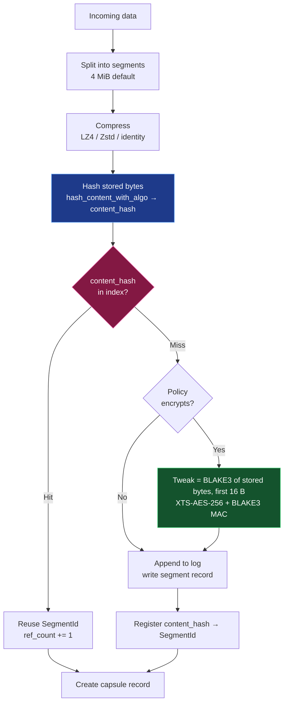

# Encrypted Deduplication Flow

SPACE deduplicates segments even when they're stored encrypted. Two properties make that work:

- The dedup index is keyed on a hash of the *pre-encryption* bytes, so the index never deals with ciphertext.
- The XTS tweak is derived from the segment's own bytes. Identical compressed segments therefore encrypt to identical ciphertext under the same key version, and a shared segment can be decrypted by any capsule that references it.

This describes the post-reset `main` branch. Encryption is only reachable through the library API for now ([#82](https://github.com/saworbit/SPACE/issues/82)).

Source:

- `crates/pipeline/src/lib.rs`: `Pipeline::write_capsule`, `read_capsule_stream`, `XtsEncryptor`
- `crates/dedup/src/lib.rs`: `hash_content_with_algo`
- `crates/encryption/src/xts.rs`: XTS-AES-256, `derive_tweak_from_hash`
- `crates/encryption/src/mac.rs`: BLAKE3 keyed MAC

## Write path

1. **Segment:** split the input into chunks of the layout policy's size (4 MiB by default).
2. **Compress:** LZ4 or Zstd, skipped for high-entropy data. Produces the bytes to store and an algorithm label.
3. **Hash:** `content_hash = hash_content_with_algo(stored_bytes, algo)`, with `+xts-aes-256` appended to `algo` when the policy enables encryption. This is the dedup key.
4. **Dedup check:** look up `content_hash` in the registry's content index.
   - **Hit:** increment the existing segment's `ref_count` and reuse its `SegmentId`. Nothing is encrypted or written.
   - **Miss:** continue.
5. **Encrypt** (if the policy enables it):
   - a segment under 16 bytes is stored uncompressed and zero-padded to 16 bytes;
   - tweak = first 16 bytes of `BLAKE3(stored_bytes)`;
   - XTS-AES-256 with the current key version;
   - 16-byte BLAKE3 keyed MAC over the ciphertext and the encryption metadata.
6. **Store:** append the bytes to the log, write the segment record with `ref_count: 1` and the encryption fields, then register `content_hash → SegmentId`.
7. **Capsule:** after every segment, create the capsule record with its segment list and dedup stats.

## Read path

1. Look up the capsule and walk its segment IDs.
2. Read each segment's bytes and metadata record.
3. If the record says `encrypted`, verify the MAC using the recorded key version and tweak, then decrypt and strip any padding. Otherwise verify `content_hash`, and refuse the segment if the capsule's policy requires encryption.
4. If the record says `compressed`, decompress with the recorded algorithm.
5. Yield the plaintext, one segment at a time.

## Caveats

- **Equality is visible.** Deterministic encryption means anyone who can read the disk can tell which segments are identical, though not what they contain.
- **HybridKyber:** `Policy::validate` rejects `CryptoProfile::HybridKyber` together with `dedupe = true`, because a per-capsule key wrap would make shared segments unreadable. The ML-KEM wrap itself isn't implemented on this branch.

## Flow diagram

## Performance

[ENCRYPTION_IMPLEMENTATION.md](ENCRYPTION_IMPLEMENTATION.md#performance) has measured plaintext and encrypted throughput.

## Related docs

- [DEDUP_IMPLEMENTATION.md](DEDUP_IMPLEMENTATION.md): content index, ref counting, GC
- [ENCRYPTION_IMPLEMENTATION.md](ENCRYPTION_IMPLEMENTATION.md): XTS, MAC and key manager internals
